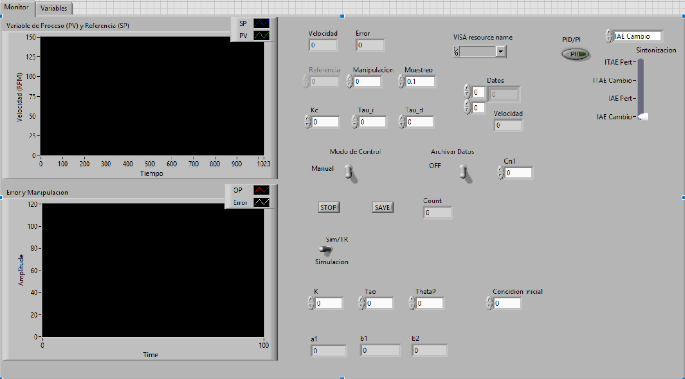
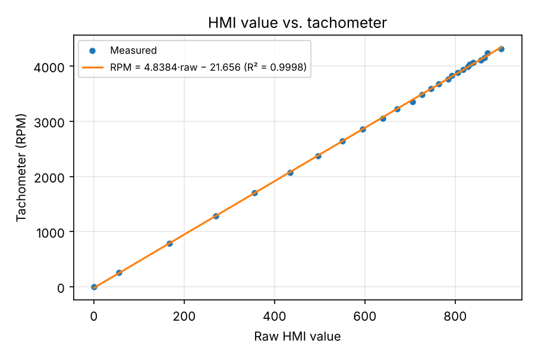
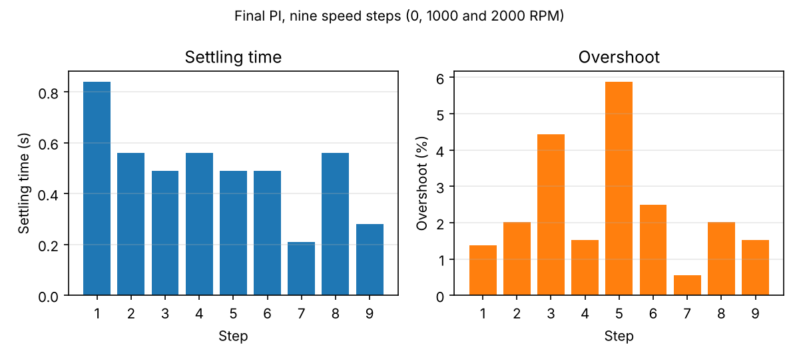

# Motor Speed HMI, System Identification & PI Control

Individual final project of the Digital Control Lab (6th semester) at Universidad de Monterrey (UDEM), January – May 2026.

Speed control of a DC motor with encoder. A LabVIEW HMI was used to run the experiments and control the motor, and MATLAB was used to identify a discrete model of the motor from an RBS test. A PI controller was then tuned with Ziegler–Nichols and fine-tuned on the real motor.




## Results at a glance

| Item | Result |
|------|--------|
| Plant | DC motor with encoder, speed in RPM |
| Sampling period | 0.07 s |
| Identified model | Second-order ARX, estimated from an RBS test |
| Model fit / RMSE | 93.5% / 16.44 RPM (one-step-ahead prediction on the RBS data used for estimation) |
| Controller | PI (Kc = 0.0456, Tau_i = 0.2331, Tau_d = 0) |
| Step tests | 9 steps between 0, 1000 and 2000 RPM |
| Settling time | 0.21 – 0.84 s |
| Overshoot | 0.56 – 5.88% |

## My contribution

The course guided the work, but each student had to program the HMI and the experiments independently. The motor, the lab setup and the microcontroller board were already assembled.

What I did myself:

- Programmed the **RBS test** in LabVIEW.
- Implemented the **conversion from the raw HMI value to RPM**, from a calibration against a tachometer.
- Tested and compared the **PI and PID tunings** on the real motor, and fine-tuned the final PI.
- Identified the ARX model in MATLAB and derived the Ziegler–Nichols gains from it.
- Added a **tuning-rule selector** (IAE / ITAE slider) to the HMI as part of a course activity. The controller gains update automatically as the slider changes.

## Hardware and software

- **Plant:** DC motor with encoder (lab setup).
- **Microcontroller:** a Tiva board that receives the HMI commands over a serial (VISA) connection and applies them to the motor.
- **HMI:** LabVIEW 2018 (with NI-VISA for the serial connection).
- **Analysis:** MATLAB R2025b (Control System Toolbox for the transfer-function steps; the ARX estimation is plain least squares).
- **Reference measurement:** handheld tachometer, used for the calibration only.

## Method

### 1. Speed measurement and calibration

The HMI receives a raw value from the board, so a handheld tachometer was used to calibrate it. The manipulated variable (OP) was increased from 10 to 254 in steps of 10, and the HMI value and the tachometer reading were recorded at each step (`data/calibration_op_sweep.csv`).

A linear fit between the raw HMI value and the tachometer gave:

```
RPM = 4.8384 · raw − 21.656      (R² = 0.9998)
```

This conversion is implemented in the HMI. Negative results are shown as 0 RPM, and positive values are shown directly.



### 2. Operating range

Speed versus OP was analysed over two ranges (OP 0–110 and OP 120–254). At high speeds the motor becomes somewhat unstable, so the lower range (OP 0 – 110) was used for the rest of the project.

### 3. Sampling period

The sampling period was chosen from the dominant-pole frequency seen in the Bode plot, ωc ≈ 9 rad/s:

```
f = ωc / 2π = 9 / 2π = 1.43 Hz
Ts = 1 / (10 · f) = 1 / (10 · 1.43) = 0.0698 s ≈ 0.07 s
```

That is, sampling about 10 times faster than that frequency.

### 4. RBS test

The RBS (Random Binary Sequence) test was programmed in the HMI. An event structure detects a button press and starts a For loop that runs for the number of samples requested. In each iteration, a random number between 0 and 1 is generated: if it is greater than or equal to 0.5, the amplitude is added to the manipulated variable, otherwise it is subtracted. A 500 ms wait gives the motor time to react.

The best results were obtained with these parameters:

| Parameter | Value |
|-----------|-------|
| Uss (operating point) | 70 |
| Amplitude | 15 (OP alternates between 55 and 85) |
| Number of samples (HMI setting) | 150 |
| Sampling period | 0.07 s |
| Recorded data | 429 samples (about 30 s) |

Several RBS tests were run, and this one gave the lowest error and the best fit.

### 5. ARX model

A MATLAB script estimated a second-order ARX model with least squares from the chosen RBS test. The input is OP minus the operating point (70), the output is RPM minus its steady-state value, and isolated glitches in the speed signal are corrected before estimating.

```
y(k) = −a1·y(k−1) − a2·y(k−2) + b1·u(k−1) + b2·u(k−2)
```

Result:

```
G(z) = (8.278368 z⁻¹ − 1.896353 z⁻²) / (1 − 0.976483 z⁻¹ + 0.202423 z⁻²)
```

The fit is 93.5% and the RMSE 16.44 RPM. Both are computed from **one-step-ahead predictions on the same RBS data used for the estimation**, so they measure how well the model predicts the next sample, not an independent validation.

As an additional check, the model was compared with a real step of 15 in OP (from 70 to 85). The ARX model and the equivalent continuous model both give a gain of 28.25 RPM/OP, while the real motor gave 26.38 RPM/OP, a little lower.

### 6. PI tuning

The ARX model was converted to continuous time (Tustin) and approximated by a first-order model with dead time using the two-point method:

| Parameter | Value |
|-----------|-------|
| Gain K | 28.25 RPM/OP |
| Time constant τ | ≈ 0.21 s |
| Dead time L | 0.07 s (minimum allowed, one sample) |

Ziegler–Nichols open-loop rules were then applied:

```
PI:   Kc = 0.9·τ / (K·L),   Tau_i = 3.33·L
PID:  Kc = 1.2·τ / (K·L),   Tau_i = 2·L,   Tau_d = 0.5·L
```

| Controller | Kc | Tau_i | Tau_d |
|------------|----|-------|-------|
| PI (Ziegler–Nichols) | 0.0956 | 0.2331 | 0 |
| PID (Ziegler–Nichols) | 0.1274 | 0.14 | 0.035 |
| **PI (final, fine-tuned)** | **0.0456** | **0.2331** | **0** |

The PID was discarded: on the real motor, the derivative action produced a large steady-state error and an unstable response. The PI worked well, but showed a strong initial overshoot when going from 0 to 1000 RPM, so Kc was reduced to remove it.

### 7. Final results

Step tests with the final PI (`data/pi_step_tests.csv`):

| Step | Transition (RPM) | Settling time (s) | Rise time (s) | Overshoot (%) |
|------|------------------|-------------------|---------------|---------------|
| 1 | 0 → 1000 | 0.84 | – | 1.38 |
| 2 | 1000 → 2000 | 0.56 | 0.21 | 2.01 |
| 3 | 2000 → 1000 | 0.49 | 0.14 | 4.43 |
| 4 | 1000 → 2000 | 0.56 | 0.21 | 1.53 |
| 5 | 2000 → 1000 | 0.49 | 0.14 | 5.88 |
| 6 | 1000 → 2000 | 0.49 | 0.21 | 2.5 |
| 7 | 2000 → 1000 | 0.21 | 0.14 | 0.56 |
| 8 | 1000 → 2000 | 0.56 | 0.21 | 2.01 |
| 9 | 2000 → 1000 | 0.28 | 0.14 | 1.53 |

The rise time of step 1 is left out because the value could not be verified.



[ARX model fit on RBS data](docs/arx_fit.png)
[Step comparison: real vs ARX](docs/step_comparison.png)


## Using the HMI

1. Connect the board and select its serial (VISA) port in the HMI.
2. Set the HMI to **real-time mode**.
3. Enter the PI or PID values (Kc, Tau_i, Tau_d).
4. Start the program.
5. Change the setpoint while it runs to see the response.

## Repository contents

```
.
├── data/   Calibration data and PI step test results (CSV)
├── docs/   Plots
└── README.md
```

## Code availability

The LabVIEW VIs and MATLAB scripts are not published here because this assignment is reused in the course every semester. They are available on request: eugenio.romo15@gmail.com

## Author

Eugenio Romo García — Mechatronics Engineering, Universidad de Monterrey
[GitHub](https://github.com/EugenioR0m0)
